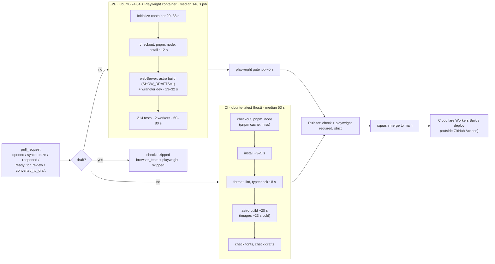
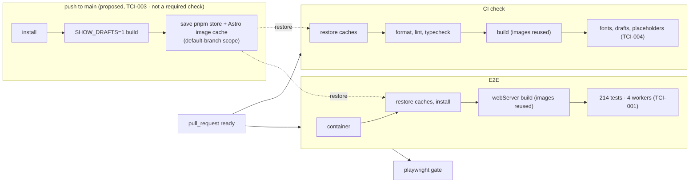

# Test and CI efficiency audit: david-krapka

- Date: 2026-11-19
- Scope: GitHub Actions validation for pull requests (`.github/workflows/ci.yml`, `.github/workflows/e2e.yml`; `claude.yml` only for triggers), the Playwright suite in `tests/e2e/`, the build and post-build scripts the workflows call, and the `protect-main` ruleset. Cloudflare Workers Builds (deployment) is outside the scope except as the release boundary.
- Audited project commit: `6119633` on `feat/systerna-case-study`, clean. Its tree is identical to `main` at `7ae6a44` (squash merge of #46; `git diff HEAD origin/main` is empty).
- Toolkit commit: `93655271c449dd4563b48bd69218a0cc12511451` (`ai-audit-toolkit`, resolved through the skill symlink)
- Toolkit working tree: clean
- Previous audit: none for test/CI. Related: `docs/audits/2026-11-09/security.md` (workflow permissions, SEC-001 action pinning), `docs/audits/2026-11-09/production-launch.md`.
- Evidence sources and access limitations: workflow and config files; GitHub run list (last 200 runs, 2026-11-05 to 2026-11-19), job/step timings of the 11 most recent ready-state runs of each workflow, full logs of 4 E2E runs and 1 `check` run (kept outside the repository); `protect-main` ruleset via the API; GitHub Actions cache listing; installed Astro 7.4.5 image-cache source; GitHub and Playwright documentation read on 2026-11-19. One bounded local measurement in a disposable clone (see Baseline). No cloud run was dispatched or rerun. CPU/memory telemetry of CI runners is not available.

## Executive summary

CI is already small and healthy. Ready-state feedback takes a median of **about 2.6 minutes**, set entirely by the E2E workflow; `check` finishes in under a minute in parallel. Across 59 successful and 1 failed runs since 5 November there were no cancellations and no retry recoveries. The one failure was a real regression that failed its retry too.

Two changes would shorten the critical path without dropping any check:

1. **TCI-001: Playwright runs 2 workers on a 4-vCPU runner.** It uses the default of half the cores. Test scheduling is already efficient, so the worker count is the limit. In a local trial, 4 workers cut the full E2E command from 47.8 s to 32.7 s. The CI gain is estimated at 15–35 s and needs measuring.
2. **TCI-002: every build re-optimises all 140 images from scratch.** That takes about 23 s of a 24 s build. Locally, a warm Astro image cache cut the build from 9.0 s to 0.6 s, with byte-identical output. The catch is that GitHub caches written by one PR are invisible to other PRs. Since CI runs only on `pull_request`, a cross-PR cache hit needs a small cache-warming run on `main` (TCI-003). That is a policy change for David to approve.

Together they could bring E2E from about 155 s to roughly 100–115 s (estimate). Container start-up (20–38 s) remains the largest fixed cost.

There is one gate-parity gap that is unrelated to speed: CI does not run `pnpm placeholders --fail`, although `pnpm verify` does (TCI-004).

| Severity | Confirmed | Suspected |
| --- | ---: | ---: |
| Critical | 0 | 0 |
| High | 0 | 0 |
| Medium | 0 | 0 |
| Low | 4 | 0 |

## Release blockers

None. Speed alone is not a release blocker, and the required checks are correctly enforced.

## Coverage log

| Area or component | Coverage | Evidence or sampling method | Limitation |
| --- | --- | --- | --- |
| Workflows and triggers | Reviewed | All three workflow files; `pull_request` event types; concurrency; draft skip; gate job | YAML plus observed runs; event-delivery races not testable statically |
| Required checks | Reviewed (live, read-only) | `protect-main` ruleset: required `check` and `playwright` from GitHub Actions (integration 15368), strict up-to-date policy, squash only | — |
| Run history | Reviewed | 200 runs: 59 success, 1 failure, 110 skipped (draft), 0 cancelled; Claude review runs excluded from counts | Window starts 2026-11-05 |
| Step timings | Sampled | 11 most recent ready runs of each workflow (2026-11-09 to 2026-11-19) | Small sample; no repeated runs of one revision |
| E2E logs | Sampled | 4 full logs (#41, #44 failing and passing, #45, #46) | List reporter gives per-test durations, not worker IDs |
| Playwright suite | Reviewed structure, sampled assertions | 9 spec files, 214 tests, 1 project (Desktop Chrome); axe scans in `smoke`, `shell`, `landing`, `case-study`; `approach-motion.spec.ts` read in full | Other specs' assertions sampled via grep, not read line by line |
| Build and post-build scripts | Reviewed | `astro.config.mjs`, `package.json` scripts, Astro 7.4.5 `assets/build/generate.js` and `assets/utils/hash.js` | — |
| Caches | Reviewed | `gh cache list`; setup-node logs | Account-level storage settings not checked |
| Deployment (Workers Builds) | Skipped | Out of scope; separate service | Its build minutes are separate (decision 0007) |

## Test and CI assessment

### Objective

The request is CI speed, read as **time from marking a PR ready (or pushing to a ready PR) until both required checks report**. The repository is public, so standard-runner minutes are free (decision 0002; GitHub documents 4 vCPU / 16 GB for public-repo Linux runners). Runner-minutes and billed cost are secondary, and reliability must not get worse. The Budget-conscious policy (drafts skip, ready runs everything) stays as it is. Nothing below changes when validation runs, except TCI-003, which adds a run on `main` and is flagged as a policy decision.

### Current architecture

The two workflows run in parallel. E2E is always the critical path: it finished 70–125 s after `check` in every sampled pair. The two jobs build with different settings (`SHOW_DRAFTS=1` in E2E), so the second build is not a removable duplicate.

### Execution conditions

| Phase/project | Effective CPU/memory and competing jobs | Tool version and configured/observed workers | Cache type, location, state | Selected/passed/failed/skipped |
| --- | --- | --- | --- | --- |
| `check` | GitHub-hosted public runner (4 vCPU / 16 GB documented; telemetry not available); runner image Ubuntu 26.04 (`ubuntu-latest`) | Node 26 (`.nvmrc`), pnpm 12.9.1, Astro 7.4.5 | setup-node pnpm store: never restored across PRs (TCI-003); Astro image cache: none, cold every run (TCI-002) | All steps; no unit tests (`--if-present test` is a no-op) |
| `browser_tests` | Same runner class, `ubuntu-24.04` host, Playwright container `v1.64.1-noble`, `--user 1001`, no CPU limit set; `wrangler dev` (workerd) runs on the same machine | @playwright/test 1.64.1; `workers` unset → default 50% of logical cores → **observed 2** in all 4 logs; `fullyParallel: true`; `retries: 1` on CI | Same as above (container store path, separate cache entry) | 214 tests (211 before #46), 1 project; latest run 214 passed |

### Risk coverage and gates

| Protected behaviour or risk | Existing tests and boundary | Current gate | Proposed membership | Boundary and coverage retained |
| --- | --- | --- | --- | --- |
| Formatting, lint, types | `format:check`, `lint`, `typecheck` | `check` (required) | Keep | Unchanged |
| Production build succeeds; fonts cover all characters; drafts absent from public build | `build`, `check:fonts`, `check:drafts` on a non-draft build | `check` | Keep | Unchanged; TCI-002 reuses only image transforms, still rebuilds every page |
| No `[…]` placeholders in the built site | `pnpm placeholders --fail` (local `verify` only); partial: `shell.spec.ts:71` (privacy pages only) | **Not in CI** (TCI-004) | Add to `check` | Would match `pnpm verify` |
| Pages, navigation, i18n, SEO metadata, headers, 404 and trailing slash as served by Workers | Playwright against the real build through `wrangler dev` (`smoke`, `shell`, `seo`, `case-study`, `landing`) | `playwright` (required) | Keep all; more workers only | Same tests and boundary |
| Accessibility (axe) at several widths | `AxeBuilder` in `smoke`, `shell`, `landing` (1280/768/320), `case-study` | `playwright` | Keep | No matrix change proposed |
| Motion, pause control, reduced-motion, no-JS behaviour | `motion`, `approach-motion`, `portrait-motion` (real Web Animations, waits on conditions) | `playwright` | Keep, unchanged | The real-animation waits are intentional; see "not recommended" |
| Faulty deploy to production | Workers Builds deploys `main` after merge; strict required checks mean a merge always follows green checks on an up-to-date branch | Ruleset | Keep | — |

### Baseline and bottlenecks

All CI numbers are `measured (CI)` from step and job timestamps. Each describes the named interval, at 1 s resolution.

| Stage or metric | Evidence | Observed result (n = 11 unless stated) | Note |
| --- | --- | --- | --- |
| E2E workflow, created → completed | Run list | median 155 s, range 128–226 s | The 226 s run had a 67 s `setup-node` outlier (11-09 08:04) |
| `check` job | Job timestamps | median 53 s, range 40–99 s | 99 s run: the same setup-node outlier |
| E2E `Initialize containers` | Step | 20–38 s | Image pull; layers partly present on runner |
| E2E checkout + pnpm + node + install | Steps | ~10–15 s (excluding outlier) | Install 2–4 s |
| E2E webServer (build with drafts + `wrangler dev` ready) | Log: `[WebServer] $ astro build` → `Running 214 tests` (n = 4) | 31 s, 13 s, 26 s, 32 s | Mostly image optimisation |
| E2E test phase, 2 workers | Log: `Running` → summary (n = 4) | 60 s, 61 s, 74 s, 80 s | — |
| Sum of individual test durations | Log, per-test times (n = 4) | 117 s, 117 s, 142 s, 153 s | Excludes worker start-up and fixtures |
| `check` build step | Step | median 20 s, range 15–30 s | Latest log: images 23.0 s of a 24.0 s build; 140 images transformed |
| pnpm store cache | Logs (n = 5) | `reused 0, downloaded 400` in every sampled run | Saves 111–132 MiB per job, 3–5 s post-step |
| Reliability | Run list, 200 runs | 1 failure / 60 ready runs; 0 cancelled | The failure (#44, `case-study.spec.ts:247`) failed its retry too and was fixed by the next commit: a real regression, not a flake |
| Gate job `playwright` | Job timestamps | ~2 s queue + ~3 s run | Required by design |

**Scheduling.** With 2 workers, the test phase (60–80 s) is within a few seconds of the sum of test durations divided by 2 (58–77 s). `fullyParallel` schedules individual tests, so there is no large idle tail. The bound is the worker count, not uneven scheduling. The ideal lower bound at 4 workers would be 29–38 s of test time. Contention with `wrangler dev` and four Chromium instances will keep the real figure above that.

**Retry amplification.** `retries: 1` retries only the failing test, about 5 s in the one observed failure. That is negligible.

#### Local measurement (`measured (local macOS)`, not CI)

Run in a disposable clone of `6119633` in the session scratchpad: Node 26.13.0, pnpm 12.9.1, 8 logical cores, Chromium from Playwright 1.64.1. Source repository Git status was clean before and after.

| Scenario | Result | Note |
| --- | --- | --- |
| `pnpm build`, Astro cache removed | 9.04 s (images 8.19 s), 140 transforms | — |
| `pnpm build`, warm `node_modules/.astro` | 0.57 s, 140 × `reused cache entry` | — |
| Output comparison | `diff -rq` of cold and warm `dist/`: identical | — |
| `SHOW_DRAFTS=1 pnpm build`, warm | 0.58 s, 140 reused | The same transforms serve both builds |
| `CI=1 playwright test --workers=2` | 214 passed, 47.8 s (whole command incl. warm build and wrangler) | 1 run |
| `CI=1 playwright test --workers=4` | 2 runs, both 214 passed, no retries; kept log 32.7 s | Second run overwrote the first log, so only one duration is recorded |

The local host has twice the cores of the CI runner and was warm. These numbers show the mechanism, not the CI gain.

### Findings

#### TCI-001: E2E runs on half the runner's cores

- Severity: Low
- Confidence: High (mechanism), Medium (size of gain)
- Status: Confirmed
- Previous finding: none
- Location: `playwright.config.ts:11-30` (no `workers`); `.github/workflows/e2e.yml:19-24`
- Evidence: All 4 sampled CI logs print `Running 2xx tests using 2 workers`. Playwright's default is 50% of logical cores, and the public-repo runner has 4 vCPU. The test phase (60–80 s) tracks the sum of test durations divided by 2, so more workers would shorten it. Locally, 4 workers instead of 2 cut the whole command by 15 s (−32%), with 2/2 green runs.
- Counter-evidence: Several motion tests wait for real animations, and `motion.spec.ts:58` pauses at fixed fractions of the cycle. Under CPU contention, more parallelism can cause timing flakes. `wrangler dev` and the browsers share the same 4 vCPUs, and CI CPU telemetry is unavailable, so the CI gain is an estimate: 15–35 s off the E2E critical path.
- Impact: About 10–20% of ready-state feedback time on every ready run.
- Remediation: `workers: process.env.CI ? 4 : undefined` (or `'100%'`) in `playwright.config.ts`. Optionally try 3 first.
- Verification: In the implementing PR, once David allows it to be marked ready, compare the `Running`→summary interval against the 60–80 s baseline. Ask for 3–5 runs of the same revision (manual reruns, owner-authorised) and require 0 retry recoveries. Stop and revert if any retry recovery or new failure appears. Test count must stay 214.

#### TCI-002: Image optimisation is recomputed cold in every build

- Severity: Low
- Confidence: High (mechanism and local result), Medium (CI gain)
- Status: Confirmed
- Previous finding: none
- Location: `.github/workflows/ci.yml:33` (`pnpm build`); `playwright.config.ts:23` (webServer build); Astro cache dir `node_modules/.astro/assets` (default `cacheDir`)
- Evidence: In the latest `check` log, `generating optimized images` took 23.0 s of a 24.0 s build. The E2E webServer phase is 13–32 s for the same reason. Neither workflow caches `node_modules/.astro`. Locally, the warm cache cut the build from 9.0 s to 0.6 s, and the output was byte-identical.
- Cache correctness: Astro 7.4.5 names cache entries with a hash of the transform options and the source URL (`assets/utils/hash.js:52`). For imported images that URL carries Vite's content hash, so changing a source image or its transform creates a new entry. The hash does **not** include the sharp or Astro version, so the cache key must include `pnpm-lock.yaml`.
- Counter-evidence: Caches written by `pull_request` runs are scoped to the PR's merge ref and cannot be restored by other PRs (GitHub docs). A cache saved by PR runs only helps later ready runs **of the same PR**, and only 2 of the 11 sampled PRs had more than one. Without TCI-003, the expected gain is small.
- Impact: With a default-branch cache, about 20 s off `check` and 10–30 s off the E2E critical path (estimate). New or changed images still cost their own transform time.
- Remediation: Add an `actions/cache` step before the build in both jobs:
  - `path: node_modules/.astro/assets`
  - `key: astro-img-${{ runner.os }}-${{ hashFiles('pnpm-lock.yaml') }}-${{ hashFiles('src/**/*.png', 'src/**/*.jpg', 'src/**/*.jpeg', 'src/**/*.webp', 'src/**/*.avif', 'astro.config.mjs') }}`
  - `restore-keys: astro-img-${{ runner.os }}-${{ hashFiles('pnpm-lock.yaml') }}-`

  The E2E job runs in a container, so check that the path resolves inside the workspace. Content-addressed entries make a partial (restore-key) hit safe. Stale entries reset whenever the lockfile changes.
- Verification: In CI, look for `reused cache entry` lines and the build/webServer interval on a warm run. Compare `pnpm check:fonts`, `check:drafts` and the E2E result with a cold run. Test a cold path once by bumping a key prefix. Rollback: remove the step; builds simply run cold again.

#### TCI-003: Dependency and build caches never cross PRs

- Severity: Low
- Confidence: High
- Status: Confirmed
- Previous finding: none
- Location: `.github/workflows/ci.yml:3-5`, `.github/workflows/e2e.yml:4-6` (only `pull_request`); `cache: pnpm` at `ci.yml:27`, `e2e.yml:34`
- Evidence: Every sampled install reports `reused 0, downloaded 400`. `gh cache list` shows two new 111–132 MiB entries per PR with the same key, each under its PR scope. No workflow runs on `main`, so no default-branch cache exists for PRs to restore.
- Counter-evidence: The install itself takes only 2–5 s, and saving the cache costs 3–5 s per job. On its own, the pnpm cache problem is nearly free to leave as it is. It matters because it also blocks TCI-002.
- Impact: TCI-002's saving is unavailable on the first ready run of each PR, which is most runs. There is a small amount of wasted save time and cache storage (well under the 10 GB limit).
- Remediation (owner decision): add a `push: branches: [main]` trigger to a **cache-warming job only**. It would install, build (`SHOW_DRAFTS=1` gives the superset of images) and save caches, without being a required check. This adds one short run per merge on free public-repo minutes. It does not change PR validation, but it is a new run type under decision 0002. If David prefers not to add it, drop `cache: pnpm` instead, which saves about 3–5 s per job.
- Verification: After one merge, the next PR's first ready run shows `Cache restored` and `reused 400` for pnpm, plus reused image entries. Confirm that the warming job cannot be mistaken for, or replace, the `check`/`playwright` required checks (different job names; ruleset unchanged). Rollback: remove the trigger.

#### TCI-004: CI does not run the placeholder check that `pnpm verify` runs

- Severity: Low
- Confidence: High
- Status: Confirmed
- Previous finding: none (introduced by `e5b7a0c`, "add `pnpm placeholders --fail` to verify")
- Location: `.github/workflows/ci.yml:29-35` compared with `package.json` `verify`
- Evidence: `verify` ends with `pnpm placeholders --fail`, but the `check` job stops at `check:drafts`. The only E2E coverage is the privacy pages (`tests/e2e/shell.spec.ts:71`). AGENTS.md lists the script as part of `verify` and does not say it is meant to be local-only.
- Counter-evidence: Agents are told to run `pnpm verify` before review, so a placeholder normally gets caught locally. A PR edited in the GitHub UI, or one where that step was skipped, would not be caught.
- Impact: A `[…]` placeholder in a case study could reach production through Workers Builds after a green CI.
- Remediation: Add `- run: pnpm placeholders --fail` after `check:drafts` in `ci.yml`. It runs in under a second on the existing `dist/`.
- Verification: CI step passes on the current tree. A deliberate placeholder in a throwaway branch fails `check`. Do not merge that branch.

### Proposed flow (proposal, not implemented)

### Prioritised optimisation backlog

| Finding, category, priority | Proposed change | Expected benefit and confidence | Risk and effort | Validation and rollback |
| --- | --- | --- | --- | --- |
| TCI-001 · quick win · **act now** | `workers: 4` on CI | Feedback −15 to −35 s (estimate, Medium); same runner-minutes or fewer | Timing flakes in motion tests (Medium likelihood, guarded by retries=1 and the stop rule); effort Low | 3–5 owner-authorised runs, 0 retry recoveries, 214 tests; revert one line |
| TCI-004 · quick win (gate parity) · **act now** | Add `placeholders --fail` to `check` | Reliability: closes a gap; +<1 s | None; effort Low | Pass now, fail on a throwaway placeholder; remove the step |
| TCI-002 + TCI-003 · CI architecture · **prepare, owner decision** | Astro image cache in both jobs, warmed by a non-required `push: main` job | Feedback −10 to −30 s on E2E, about −20 s on `check` (estimate, Medium); one extra short run per merge | Stale cache if the key misses an input (mitigated by the lockfile in the key and content-addressed names); adds a run type under 0002; effort Low–Medium | Warm vs cold timings, unchanged check results, one forced cold run; remove the cache step and trigger |
| TCI-003 alone · quick win · **only if the warming run is declined** | Drop `cache: pnpm` | −3 to −5 s per job (measured post-step) | None | Install time stays 2–5 s; re-add the line |

#### Considered and not recommended (now)

- **Keep the current setup.** It is adequate: 2.6 min median, no flakes, correct gates. The items above are improvements, not fixes.
- **Shard E2E across 2 jobs.** Each shard repeats container start-up, install and build (about 45–80 s) to save 30–40 s of tests. That roughly doubles runner time for little or no wall-clock gain. Revisit if the test phase passes about 3 min.
- **Merge `check` into the E2E job.** Saves one install and build but serialises about 40 s of static checks before the E2E result arrives, which makes feedback slower.
- **Run E2E on the host instead of the container.** It would need `playwright install --with-deps chromium` (apt dependencies plus browser download), probably similar to the 20–38 s container start. Not measured; defer.
- **Reuse the `check` build in E2E.** The two builds differ (`SHOW_DRAFTS=1`) and run in parallel, so reusing it would change what E2E tests or delay it.
- **Fake animation time in `approach-motion`.** 8 tests take about 2.7 s each, around 22 s of worker time. Speeding up the clock would stop testing real Web Animations, which these tests exist to check.
- **Remove the `playwright` gate job.** It costs about 5 s but is what keeps a skipped draft run from counting as a pass (decision 0002).
- **Larger or self-hosted runners.** Larger runners are billed even for public repos. Self-hosted runners must not run untrusted fork PR code in a public repository.
- **Skip E2E on docs-only PRs (path selection).** About a third of recent PR branches are `docs/*`, and the build does not read `docs/`, so this would save a full E2E run on them. It is a scheduling and coverage policy change, though. It would need a job-level filter whose gate job states "docs-only, skipped" explicitly, because a workflow-level `paths` filter would leave required checks pending. Defer to David.

### Measurement plan

1. Baseline (already collected): the 11 ready runs above. Optionally extend the window with `gh run list` and `gh run view --json jobs`.
2. After TCI-001: compare the E2E `Running`→summary interval and job duration over at least 3 runs of one revision, plus the next 5 PRs. Acceptance: median test phase ≤ 50 s with 0 retry recoveries. Stop at the first retry recovery and investigate before going on.
3. After TCI-002/003: record cold (first run after a lockfile change) and warm runs separately, using build-step and webServer intervals and `reused cache entry` counts. Acceptance: warm build ≤ 5 s of image work, identical check results.
4. Report runner-minutes as a sum of job durations. Do not convert them to money: public-repo standard minutes are free under decision 0002.

## Not verified

| Area | Why | Evidence needed | How to get it |
| --- | --- | --- | --- |
| CI gain from TCI-001 and TCI-002 | No cloud experiment authorised | Ready-run timings after the change | Measurement plan above |
| Effective CPU/memory inside the Playwright container | No telemetry in logs | `nproc`, `os.availableParallelism()`, memory during the test step | A diagnostic step in the implementing PR |
| Concurrency race (delayed draft-state event cancelling a ready run) | Not observable statically; 0 cancellations in 200 runs | A cancelled ready run | Watch run history. If it happens, the strict ruleset blocks merge (no unsafe outcome), so a rerun is the remedy |
| Fork-PR cache behaviour | No fork PRs in the window | — | Only relevant if outside contributions start |

## Checks without findings

- Validation uses `pull_request` (not `pull_request_target`) with `contents: read`. Required checks come from GitHub Actions with a strict up-to-date policy. The gate job fails unless `browser_tests` succeeded (`e2e.yml:49-62`).
- Draft runs skip in about 1 s, and every sampled merge had a ready-state run of its final revision.
- `retries: 1` is scoped to the failing test. The single observed failure was persistent and real, not hidden by a retry.
- Timeouts (20 min per job) are far above observed durations and do not mask hangs at this size.
- Failure artefacts (HTML report, traces on failure, 7-day retention) are uploaded only on failure.
